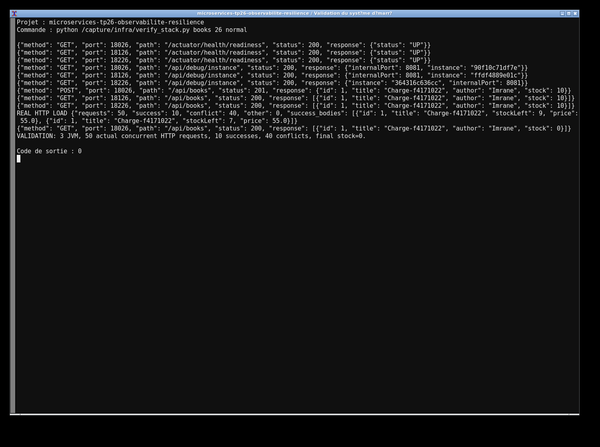
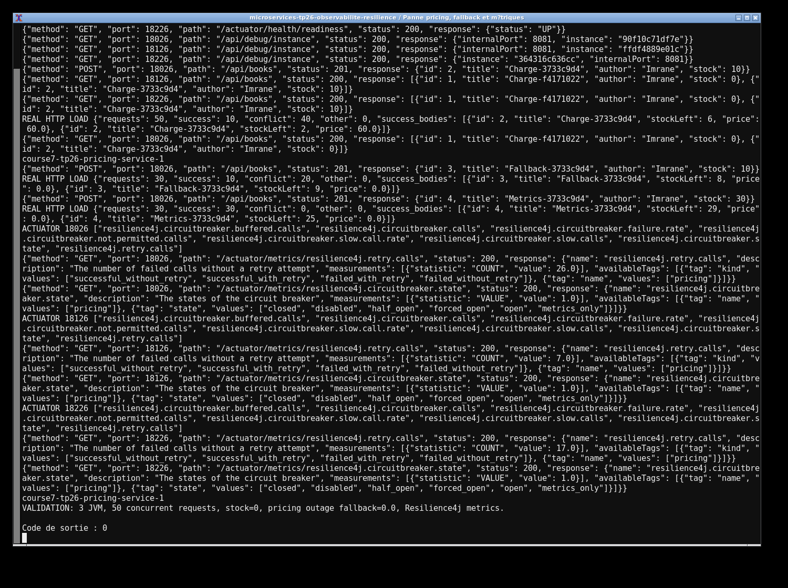
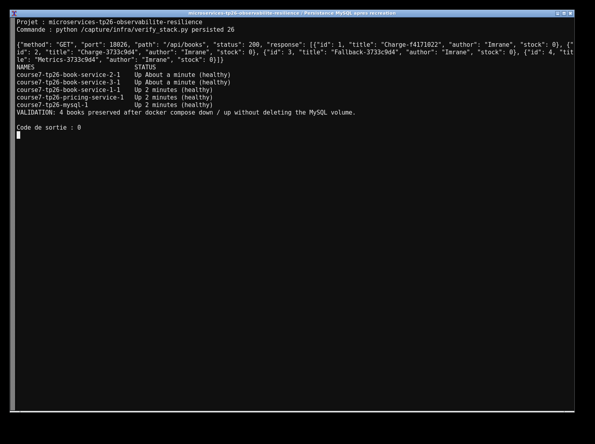

# TP26 — Livres, résilience et concurrence

 J'ai séparé les prix et les prêts de livres. Trois instances partagent MySQL et son volume. Les healthchecks attendent la base avant de lancer les services. Le stock est décrémenté sous verrou pessimiste ; l'appel HTTP aux prix a des délais maximum, trois tentatives et un circuit breaker. Le fallback est appliqué après les tentatives.

 ```sh
 mvn clean verify
 docker compose up -d --build
 python loadtest.py ID_LIVRE 50
 ```

 Les livres sont sur `http://localhost:18026/api/books` (autres instances : `18126`, `18226`), pricing sur `18326`. Le profil `dev` utilise H2 ; `docker` utilise MySQL. Pour tester le fallback, arrêter `pricing-service`, créer un livre avec du stock puis emprunter. Les métriques sont sur `/actuator/metrics`.

 Les traces d'exécution sont dans `evidence/` et les captures dans `screenshots/`.

 




